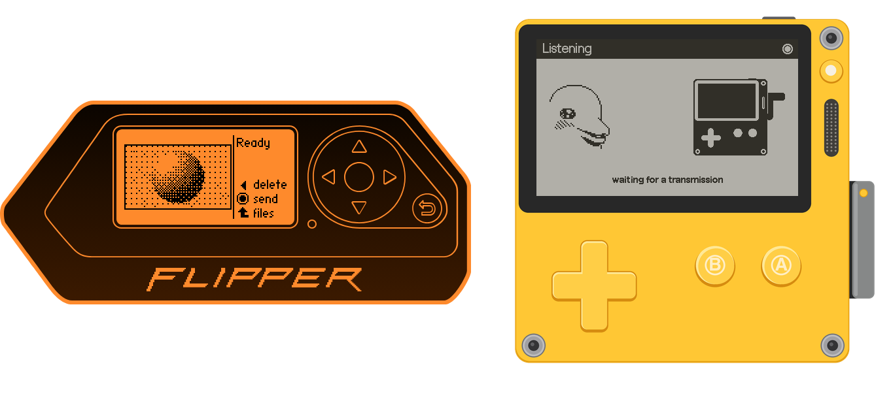

# SFTV TX: Slow Flipper TV for Flipper Zero

SFTV TX sends pictures, notes and animations to the receiver
([SFTV RX](https://github.com/Negenii/sftv-playdate) on a Playdate) as near-ultrasound
(17–21 kHz). No pairing, no radio: the receiver just listens.

## Installing

Download `sftv_tx.fap` (or build it, see below) and copy it to `apps/Tools/` on the Flipper's
SD card, with qFlipper's file manager or a card reader. It shows up in Apps → Tools. The app
is built for [Momentum](https://momentum-fw.dev) firmware.

To update, copy the new version over the old one. Your pictures stay: they live apart from
the app, in `apps_data/sftv_tx/`.

## Getting started

1. In TX, pick a picture, an animation or a note and send it. Six pictures come with the app,
   and any JPEG, PNG or BMP on the SD card can be sent too.
2. Keep the transmitter close to the receiver, 3–10 cm.

The picture goes out line by line. It goes slowly: that's why it's a slow TV. If parts get
lost, Options → Calibrate shows how well the receiver hears the transmitter; aim for 80 % or
more.

## Building

Built with `ufbt` against the Momentum SDK:

    ufbt update --index-url=https://up.momentum-fw.dev/firmware/directory.json --channel release
    tools/flipper_build.sh launch    # build, install and start on a connected Flipper

`tools/flipper_build.sh` bumps the build number in `flipper/BUILD` (shown in Options → About);
plain `cd flipper && ufbt launch` works too. Host tests of the shared protocol code:
`cd tests && make test`.

Layout: `flipper/` the app, `common/` the protocol in portable C (shared with SFTV RX),
`tests/` host tests and WAV tools, `tools/` picture generators, `images/` sample pictures,
`docs/` design notes.

## Protocol

8-FSK, 17.0–20.5 kHz, 3 ms symbols, synced by a tone pattern. 45-byte frames with
Reed-Solomon parity, interleaved in blocks of four, plus an outer Reed-Solomon code across
groups of 108 frames, so a lost frame comes back without a resend. Pictures go raw or with a
lossless line codec, animations with an adaptive binary range coder. The details are in
`docs/` and `common/sstv_params.h`.

## Credits and licenses

© 2026 negenii. Released under the GNU General Public License v3.0 (see `LICENSE`).

- JPEG decoding: TJpgDec by ChaN (its own permissive license, in the source).
- PNG decoding: uzlib by Paul Sokolovsky and contributors (zlib license, `flipper/lib/imgdec/LICENSE.uzlib`).
- The dolphin animations the app sends are the ones already on your Flipper; the dolphin art
  in the app comes from the Flipper Zero firmware (GPL-3.0).
- `docs/sftv.png` is a recording of one transmission, sped up: SFTV TX sending on the left,
  SFTV RX receiving on the right. The Flipper body is qFlipper's device art (GPL-3.0); the
  Playdate is drawn for this project from simple shapes.

If you like it, you can buy me a coffee:

